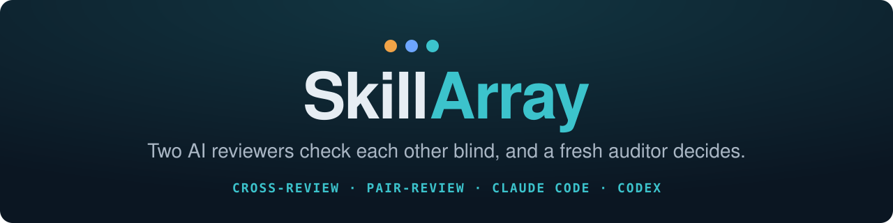

<p align="center">
  
</p>

<p align="center">
  
  
  
  
</p>

**One AI reviewer misses things and sounds sure anyway. Two reviewers that check each other catch them.** In 160 reviews
of my own work, the final check confirmed 2,135 findings: a Claude reviewer alone would have missed 28% of them, an OpenAI
reviewer alone 43%.

SkillArray is two Claude Code and Codex skills that review your code, design documents or other documents with two AI
models instead of one. Each model reviews on its own. Then each one sees the other's findings, with names removed, and has
to accept them or prove them wrong with evidence. A fresh session that never saw who wrote what makes the final call.

<p align="center">
  
</p>

## Why I built it

I use Claude Code for most of my work: code, design documents, websites. I started asking it to review that work too. The
reviews were useful, but one model reviewing a change tends to agree with itself, and it states a guess with the same
confidence as something it actually checked.

So I set up two reviewers and made them check each other. The figures at the top come from 160 of those cross-reviews,
each with a Claude reviewer and an OpenAI reviewer.

## Two skills

| Skill | Reviewers | Modes |
|---|---|---|
| `cross-review` | Two vendors: a Claude reviewer and a Codex reviewer | Adversarial |
| `pair-review` | Two models of one vendor: two Claude models, or two OpenAI models through Codex | Collaborate (default), adversarial, or none (no exchange) |

Both end with the same fresh audit and the same report. For high-stakes work, prefer `cross-review`: two models of one
vendor can share a blind spot.

## Quick start (Claude Code)

You need Node.js 22 or newer. The fastest way to try it is `pair-review`: it needs nothing but Claude Code. `cross-review`
also needs the [Codex CLI](https://github.com/openai/codex), installed and signed in.

1. Add the marketplace and install `pair-review`, and `cross-review` if you have Codex:

   ```text
   /plugin marketplace add M-khalifa/SkillArray
   /plugin install pair-review@skillarray
   /plugin install cross-review@skillarray
   ```

2. Pick the models each reviewer uses:

   ```text
   /pair-review setup
   /cross-review setup
   ```

   `/pair-review config` and `/cross-review config` show the current choice. Run setup again anytime to change it.

3. Run a review:

   ```text
   /cross-review -- review the changes in this branch
   /pair-review adversarial -- check this design doc against the ticket
   ```

To update: run `/plugin marketplace update skillarray`, then `/plugin update pair-review@skillarray` and
`/plugin update cross-review@skillarray`. While two builds carry the same version number, the updater may not see a change;
then uninstall and install again.

## How a review works

<p align="center">
  
</p>

1. **Alone.** Both reviewers read the same frozen snapshot and write their own findings. Neither sees the other.
2. **Blind cross-examination.** Each reviewer gets the other's findings with the model names removed. It accepts each one,
   or refutes it with a command and its output, or the exact lines.
3. **Final call.** A fresh auditor re-checks every finding, also the ones both reviewers agreed on, because agreement is
   not proof.

A run takes 20 to 30 minutes for a medium change. You get a report and a `findings.json`. Each finding has a severity, the
evidence behind it, what the other reviewer said about it, and whether the auditor confirmed it.

<p align="center">
  
</p>

This is one real finding from a review of this repository's own code:

```text
F1  HIGH  confirmed by both reviewers, verified by the auditor
A packet path like "<run-dir> 2\..\run\..." passed the run-directory guard,
so the auditor could have been pointed at files it must not read.
Fix: refuse any run-directory name followed by a space.
```

## Compared with similar tools

Other open-source tools also put a second model on Claude's work, for example
[agent-peer-review](https://github.com/jcputney/agent-peer-review) (a Claude Code plugin in which Codex checks Claude's
work) and [multi_mcp](https://github.com/religa/multi_mcp) (an MCP server for multi-model chat, code review and analysis).
What SkillArray does, whichever you pick:

- Both reviewers work alone first, on the same frozen snapshot, so neither copies the other.
- The cross-examination is blind: each reviewer sees the other's findings without model names.
- A reviewer can only reject a finding with evidence: a command and its output, or the exact lines.
- A fresh auditor re-checks every finding, including the ones both reviewers agreed on.
- Two models of one vendor (`pair-review`) or two vendors (`cross-review`), with the same report and `findings.json`.

## How it has been used so far

- Real work: code changes across several repositories, design documents and website content. The largest single run
  covered 14 targets.
- 65 complete reviews with a final audit, most of them run by separate sessions that reported back what broke, what was
  slow and what it cost in tokens. I fixed what they found.
- The skills reviewed their own code before this release, on Windows, Linux and macOS: earlier rounds on Windows, seven
  rounds on Linux and two on macOS, and the test suites passed on all three. Every finding was fixed, or recorded in the
  CHANGELOG.

[CHANGELOG.md](CHANGELOG.md) lists what changed in each version.

## Things to know before you run it

- What you review is sent to the model providers you picked, under their terms. Reviewers can also run commands from the
  repository they are checking. Read [SECURITY.md](SECURITY.md) first if that matters for your code.
- The two reviewers never see each other's model names, but writing style can still give a hint. The scripts catch
  explicit leaks; they cannot catch style.
- There is no protection against prompt injection hidden in the reviewed material.
- A review uses millions of tokens, mostly cached reads, and a large codebase uses more. The manifest of each run records
  every seat's usage, so you can see what a review cost.
- I have not benchmarked this against a single reviewer yet. The `bench/` folder has the start of that work.

<details>
<summary><b>Install on Codex (Windows, macOS, Linux)</b></summary>

Install or update the Codex CLI and sign in:

```bash
npm install -g @openai/codex@latest
codex --version
codex login
```

An OpenAI pair uses Codex's native agents. A Claude seat, auditor, or verifier also needs an installed, authenticated
Claude Code CLI. Installing a CLI does not enable a route that this skill marks unsupported.

The quickest way is the plugin marketplace (tested with Codex CLI 0.165.0 on Windows):

```bash
codex plugin marketplace add M-khalifa/SkillArray
codex plugin add cross-review@skillarray
codex plugin add pair-review@skillarray
```

`codex plugin list` then shows both as installed and enabled. Or copy the skill folders yourself:

Codex reads skills from `.agents/skills` in the repository, or from `~/.agents/skills` for every project. Copy each complete
skill folder, including its `scripts` and `references` directories. See
[OpenAI's skill documentation](https://learn.chatgpt.com/docs/build-skills).

macOS and Linux:

```bash
git clone https://github.com/M-khalifa/SkillArray.git
mkdir -p ~/.agents/skills
cp -r SkillArray/plugins/cross-review/skills/cross-review ~/.agents/skills/
cp -r SkillArray/plugins/pair-review/skills/pair-review ~/.agents/skills/
```

Windows (PowerShell):

```powershell
git clone https://github.com/M-khalifa/SkillArray.git
New-Item -ItemType Directory -Force "$HOME\.agents\skills" | Out-Null
Copy-Item -Recurse -Force SkillArray\plugins\cross-review\skills\cross-review "$HOME\.agents\skills\"
Copy-Item -Recurse -Force SkillArray\plugins\pair-review\skills\pair-review "$HOME\.agents\skills\"
```

To update, pull the repository and replace each installed skill folder with a fresh copy. Back up any local customization
first. Merging over an older copy leaves deleted files behind, including old test fixtures named `SKILL.md` that Codex can
mistake for skills. Codex detects skill changes automatically; restart it if a skill does not show up.

Start `codex` one level above the folder you want reviewed (the review's run folder must be inside the folder Codex starts in;
keep the target there too), then call a skill with `$` (or pick it from `/skills`):

```text
$cross-review setup
$cross-review -- review the changes on this branch against main
$pair-review -- review docs/design.md for gaps and wrong claims
```

On a Codex host the routes are still a trial (see Hosts below). A pair of two native OpenAI models has completed two short
runs, and a cross-review with a Claude CLI seat has completed two: one on a small target, one on this repository's own changes.
Tested on Windows only. For cross-review, start Codex with
Claude's session folder writable, or the Claude seat cannot be resumed (tested on Windows):

```powershell
codex --sandbox workspace-write --add-dir "$HOME\.claude\projects"
```

On Windows, git inside the Codex sandbox refuses a repository the sandbox account does not own, such as one you cloned
yourself; each skill's `references/hosts/codex.md` shows how to trust it for the review only. Claude Code is the host I
test on most.

</details>

<details>
<summary><b>Hosts and supported routes</b></summary>

Support is decided per actor (host, runtime, transport), not per host (`scripts/host-support.mjs`): supported, trial (needs
`preflight.mjs --allow-trial`, recorded in `run.json` and the manifest) or unsupported (refused, no override). Claude Code:
everything is supported. Codex host: native OpenAI agents (pair-review, and cross-review's seat B) and a single-call Claude CLI auditor
are trial routes; a Claude CLI seat is a trial only after `preflight --probe-claude-session --yes-paid` proves its session survives
(Claude saves its session in `~/.claude/projects`, which the Codex sandbox can write only when you add that folder as a
writable root; see each skill's `references/hosts/codex.md`); a nested Codex CLI seat is unsupported. The skill picks
the host from the tools it has, in this order, and `preflight.mjs --host` records the choice.

| Order | Condition | Host |
|---|---|---|
| 1 | A valid `--host` value that does not contradict a tool family that is present | that value |
| 2 | Both a Claude Code and a Codex agent tool family are present | ambiguous: asks you |
| 3 | An agent-spawn tool and `SendMessage` | `claude-code` |
| 4 | The Codex agent tool family (its tool names are not observed: pass `--host codex`) | `codex` |
| 5 | None of the above | ambiguous: asks you |

Environment markers such as `CODEX_THREAD_ID` and `CLAUDECODE` are hints only. On Claude Code, seat A runs as a native agent
by default and a Codex seat uses `codex-dispatch.mjs`. On a Codex host, an OpenAI pair uses native agents, while Claude
actors use `claude-dispatch.mjs`. A nested Codex CLI seat is unsupported on that host, so a passing Claude session probe
alone does not make a cross-review configuration usable: every actor must pass the support checks. Each skill's
`references/hosts/` folder has one file per host.

**Codex sandbox.** Codex command and network access depend on the active sandbox and permission configuration. In the
Windows setup tested here, two things stopped a Claude CLI seat. The sandbox could not write `~/.claude/projects`, so
Claude lost its session and the Phase 2 resume failed. And inside the sandbox Claude Code refused every file write of
the seat as "a sensitive file". With `~/.claude/projects` added as a writable root (`--add-dir`), and the Claude seat
answering in its final message while the dispatcher writes the file, a full cross-review completed on 2026-11-01.
preflight checks that folder before the paid session probe. Earlier attempts through `codex exec` were also killed with
the Codex turn or failed on `--detach` (WMI access denied); the dispatchers now fall back to a plain detached process.
These routes stay a trial until more runs on real targets pass. The skill never requests escalation, never sets a wider
sandbox itself, and never bypasses a permission check. Details: each skill's `references/hosts/codex.md`.

Before assigning a Codex CLI seat from Claude Code, check that it can actually read the target. From the target repository,
run:

```text
codex exec --sandbox read-only --json "Run git status --short and read the first line of README.md. Report the command results."
```

Use an existing target file if the repository has no `README.md`. Check the JSON events for successful command execution and
file contents. A green `codex doctor` row, a passing preflight, or a final "No findings" response does not prove the
reviewer read any files.

On a Codex host, cross-review's seat B runs as a native Codex agent, a trial route; its Codex CLI route is unsupported, and a
passing Claude session probe does not override that. A Claude pair on a Codex host is a trial only when the session probe
passes. The native OpenAI pair-review has completed two short runs, and cross-review two (2026-11-01, one of them on a real target;
Windows). See
each skill's `references/hosts/codex.md`.

</details>

<details>
<summary><b>Repository layout and checks</b></summary>

```text
SkillArray/
|-- plugins/cross-review/skills/cross-review/   the cross-review skill
|-- plugins/pair-review/skills/pair-review/    the pair-review skill
|-- bench/                                 benchmark tooling (not installed)
|-- docs/                                  design notes and the images on this page
`-- scripts/                               repository checks
```

Each review skill installs on its own. The two share some scripts and reference files, and the repository check makes sure
those copies stay identical.

The checks need Node.js 22 or 24:

```text
node scripts/release-check.mjs
```

That runs everything in order and stops at the first failure: file checks, the shared-file comparison, the install check
and its tests, both skills' test suites and the benchmark tests. The install check (`node scripts/install-check.mjs`) copies
each skill into a scratch Claude Code layout (`.claude/skills`) and a scratch Codex layout (`.agents/skills`) and checks the
copies. `--release` also refuses uncommitted changes and tests each skill from a clean copy. Before a documentation change,
`node scripts/compare-baseline.mjs --base <rev>` checks that the briefs of an earlier revision still build byte for byte and
that every documented rule is still present. CI runs the review skills on Windows, Linux and macOS.

</details>

## License

MIT. See [LICENSE](LICENSE).
